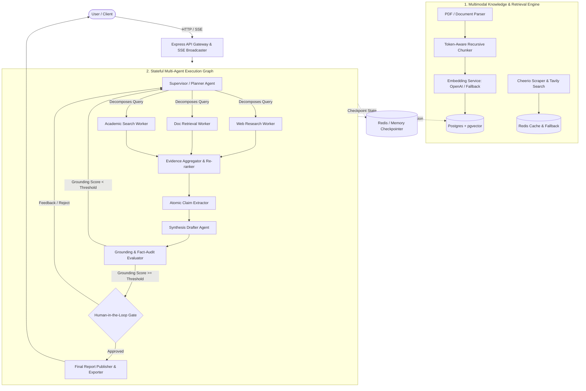

# AxiomAi 🧠🔍

> **Production-grade, stateful, autonomous multi-agent deep research and fact-audited synthesis platform in TypeScript.**

AxiomAi uses **LangGraph**, **LangChain**, **PostgreSQL (pgvector)**, **Redis**, and an adversarial **grounding & fact-auditing engine** to perform exhaustive research, decompose complex questions, accumulate multi-source evidence, extract atomic claims, verify veracity against source texts, and compose verifiable synthesis reports with full human-in-the-loop controls.

---

## 🏗️ Architecture



---

## 🗺️ 30-Phase Implementation Roadmap

### Milestone 1: Foundation & Core Infrastructure (Phases 1–5)
- **Phase 1**: Environment Configuration, Strict Type Validation & Structured Pino Logging.
- **Phase 2**: PostgreSQL Database Schema & Vector Extension Setup (`Prisma` + `pgvector`).
- **Phase 3**: Redis Distributed Cache & In-Memory Resilient Fallback Layer.
- **Phase 4**: Embedding Service with Multi-Model Support & Deterministic Offline Fallbacks.
- **Phase 5**: Express HTTP Server, Middleware Stack & SSE Event Streaming Core.

### Milestone 2: Knowledge Ingestion & Retrieval Services (Phases 6–10)
- **Phase 6**: Document Upload Pipeline & PDF Parsing Engine (`multer` + `pdf-parse`).
- **Phase 7**: Token-Aware Recursive Text Splitting & Metadata Tagging.
- **Phase 8**: Vector Store Repository & Hybrid Cosine Similarity Search (`HNSW` / `<=>`).
- **Phase 9**: Web Content Scraper & HTML Sanitizer (`cheerio`).
- **Phase 10**: External Search Engine Integration (`Tavily API` with query caching).

### Milestone 3: Multi-Agent State & Graph Infrastructure (Phases 11–15)
- **Phase 11**: LangGraph State Annotation Schema (`ResearchAnnotation`) & Zod Contracts.
- **Phase 12**: Resilient State Checkpointer (`MemorySaver` & Redis State Persistence).
- **Phase 13**: Unified LLM Client Layer (OpenAI GPT-4o / GPT-4o-mini & Groq Llama-3).
- **Phase 14**: Supervisor / Planner Agent (Query Decomposition & Sub-question DAG).
- **Phase 15**: Parallel Research Worker Nodes (Concurrent Web & Document Retrieval).

### Milestone 4: Evidence Synthesis & Fact-Auditing Engine (Phases 16–20)
- **Phase 16**: Evidence Aggregator, De-duplication & Re-ranking Filter.
- **Phase 17**: Atomic Claim Extraction Node (Deconstruction into Verifiable Propositions).
- **Phase 18**: Synthesis Drafter Agent (Multi-Section Academic Synthesis with In-Text Citations).
- **Phase 19**: Source Grounding & Fact-Audit Evaluator Node (Adversarial Verbatim Matching).
- **Phase 20**: Confidence Calibration, Hallucination Scoring & Re-Research Routing.

### Milestone 5: Human-in-the-Loop & API Workflow Control (Phases 21–25)
- **Phase 21**: LangGraph Human-in-the-Loop Interrupt & Approval Gates.
- **Phase 22**: Feedback Incorporation & Iterative Revision Loop.
- **Phase 23**: Research Session Lifecycle Management & Prisma State Synchronization.
- **Phase 24**: RESTful API Endpoints for Research Workflows (Start, Stream, Pause, Resume, Feedback).
- **Phase 25**: Real-Time SSE Progress Telemetry & Thought Streaming Broadcaster.

### Milestone 6: Hardening, Observability, Testing & Deployment (Phases 26–30)
- **Phase 26**: Report Exporter (Markdown, HTML with Hover Citations, BibTeX).
- **Phase 27**: Error Resilience, Circuit Breakers & Exponential Backoff.
- **Phase 28**: Comprehensive Vitest Suite (Unit, Graph State Transitions & Mocked LLM E2E).
- **Phase 29**: Production Containerization & Docker Compose Optimization.
- **Phase 30**: End-to-End Evaluation Benchmark, CI/CD Pipeline & Final Deployment.

---

## 🚀 Quickstart

### Prerequisites
- Node.js 20+
- Docker & Docker Compose

### 1. Setup Environment
```bash
cp .env.example .env
```

### 2. Start Infrastructure
```bash
docker compose up -d
```

### 3. Install Dependencies & Generate Database Client
```bash
npm install
npm run prisma:generate
npm run prisma:push
```

### 4. Run Development Server
```bash
npm run dev
```

---

## 📜 License
MIT

